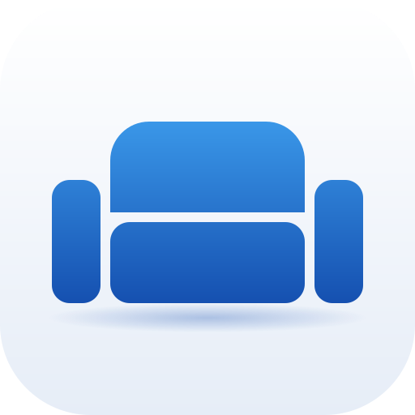
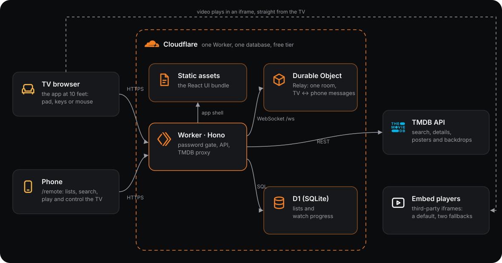

<div align="center">



# couch potato

My monitor, turned into a TV: films, series and my lists in one ad-free app, run from my phone or a controller.


</div>

> [!NOTE]
> This is a personal project, built for me and my setup. It isn't meant for anyone else to use yet: there are no accounts, no onboarding and no support, and it's shaped around my habits.

## Why I built it

I watch a lot of movies and series, and they were spread across **too many apps, each with its own ads and subscription**. I wanted **one app, with no ads, that's free**, and that **knows my lists**: what I want to watch, what I've watched and what I loved. I also live in a **small studio with one monitor that doubles as my TV**, so watching meant getting up from the couch to reach for the mouse. couch potato turns that monitor into a **TV I drive with a controller**, makes my **phone the remote** for searching and playback, and **remembers where I left off**, so I never have to leave the couch.

## How it works



Everything runs on Cloudflare, within the free tier: one Worker, one D1 database and one Durable Object.

### The Worker 

A single [Hono](https://hono.dev) app handles every request, in this order:

1. **Password gate.** The login page sets a signed session cookie. Without it, pages redirect to `/login`, and the API and WebSocket answer `401`.
2. **`/ws`.** WebSocket upgrades are handed to the relay Durable Object (same-origin only).
3. **`/api/collection`.** The lists: read, add, mark watched, favourite.
4. **`/api/*`.** The TMDB proxy (search, trending, titles, seasons) and watch progress. The TMDB key never leaves the server.
5. **Everything else.** Static assets: the React app and its icons.

The handler has no Cloudflare imports, so the whole server runs under `bun test` with in-memory fakes for D1, the assets binding and the relay.

### The phone-to-TV relay 

A single Durable Object holds one "room" in which TVs and phones meet over WebSocket:

| From | Message | Effect |
|---|---|---|
| Phone | `play` | The most recently active TV opens the player for that title or episode |
| Phone | `command` | Play, pause, seek, fullscreen, next episode, switch player or stop on that TV |
| TV | `state` | What's playing now, sent to every phone and cached for phones that join later |
| Server | `presence` / `remotes` | Phones learn whether a TV is open; TVs learn how many phones are connected |

The message types live in `shared/protocol.ts` and are checked on both sides.

### The database 

D1 (SQLite) holds two tables:

- **`collection`**: one row per title (`media_type` + `tmdb_id`), with its status, dates and favourite flag. The rules are enforced by the schema itself: a title is watched exactly when it has a watched date, and a favourite must be watched. Title, year and poster are copied from TMDB once, so lists load without calling TMDB.
- **`progress`**: position and duration per film or episode, updated as I watch.

Migrations are in `migrations/`.

### The TV and phone apps

One React 19 app serves both screens:

- **TV** (`/`): spatial navigation over real DOM focus, a Gamepad API loop for controllers, and focus following the mouse, so there is only ever one highlight.
- **Phone** (`/remote`): its own layout and tabs (Home, Lists, Remote, Explore). A phone opening the home page is sent here, and a home-screen shortcut opens it directly.

Data comes through TanStack Query. The player wraps the embed iframe, reads its progress events and saves progress back to the Worker.

## Run it locally

Notes for me, or an AI agent, to set it up again. It needs [Bun](https://bun.sh), a Cloudflare account and a free [TMDB API key](https://www.themoviedb.org/settings/api).

```sh
bun install
cp .dev.vars.example .dev.vars   # fill in TMDB_API_KEY and COUCH_PASSWORD
bun run build
npx wrangler d1 migrations apply couch-potato --local
bun run dev                      # serves on the local network, so the phone can reach it
```

Checks:

```sh
bun test
bun run typecheck
```

## Deploy to Cloudflare

```sh
npx wrangler d1 migrations apply couch-potato --remote
npx wrangler secret put COUCH_PASSWORD
npx wrangler secret put TMDB_API_KEY
bun run deploy
```

Then I open the Worker's URL on the monitor, sign in, and open the same URL on my phone to get the remote.

## Notes

- Built for one person, me: there are no accounts, just the one password.
- The app doesn't host or store video. Playback comes from third-party embed players, and their availability is outside this app's control.
- Film and series data comes from TMDB. This product uses the TMDB API but is not endorsed or certified by TMDB.
